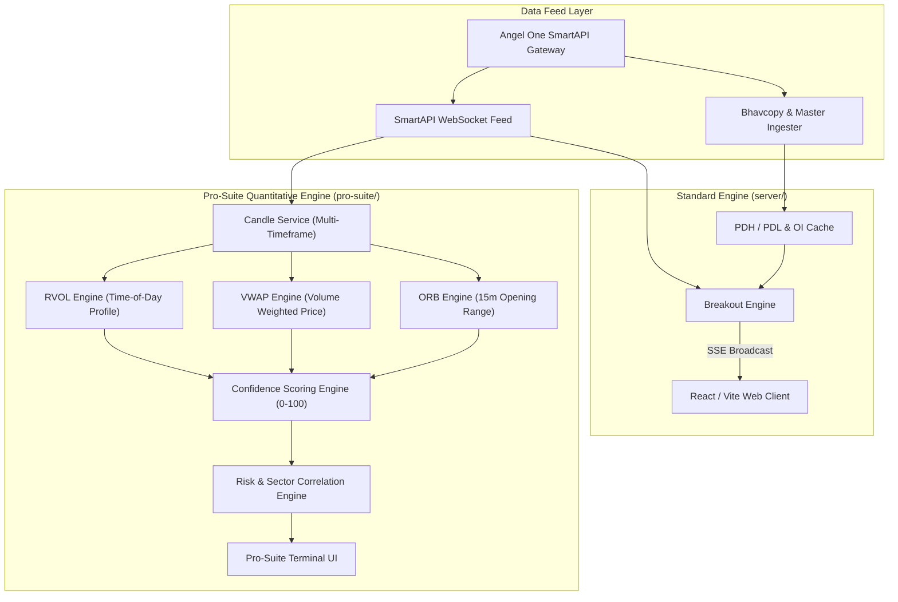

# 📊 NSE Momentum Scanner & Pro-Suite

**Institutional-Grade Real-Time Momentum Scanner, Order Flow Intelligence, and Breakout Detection Suite for the National Stock Exchange (NSE)**

[](https://nodejs.org/)
[](https://react.dev/)
[](https://smartapi.angelbroking.com/)
[](https://developer.mozilla.org/en-US/docs/Web/API/Server-sent_events)
[](https://tailwindcss.com/)

> [!IMPORTANT]
> **Regulatory & Risk Disclaimer**: This software is an engineering and market analysis platform for educational and simulation purposes. It does not provide financial advice, stock recommendations, or automated trade execution services. Trading Indian equities and derivatives involves substantial risk of loss.

---

## 📌 Executive Summary

Active day traders face information overload when tracking market-wide momentum across the NSE cash and derivatives segments. Traditional charting platforms lag or require manually cycling through watchlists.

**NSE Momentum Scanner** is a dual-tier quantitative market scanning platform:
1. **Standard Scanner Suite**: Ingests real-time tick streams via **Angel One SmartAPI**, tracks Bhavcopy historical price action, monitors Open Interest (OI) build-up, and detects multi-timeframe breakouts through high-throughput Server-Sent Events (SSE).
2. **Pro-Suite (`pro-suite/`)**: A modular quantitative engine equipped with:
   - **RVOL Calculator**: Relative volume surge tracking against 10-day time-of-day baselines.
   - **VWAP Bands & ORB**: Opening Range Breakout detection with anchored Volume Weighted Average Price standard deviation bands.
   - **Confidence Scoring Engine**: Algorithmic weighting combining volume, price momentum, open interest, and sector breadth into a unified trade readiness score (0–100).
   - **Sector Breadth & Risk Engine**: Multi-stock correlation matrices to avoid overexposure to correlated sector selloffs.

---

## 🏗️ System Architecture



---

## 🌟 Key Features

- **Live Market Telemetry**: Streaming updates pushed via Server-Sent Events (SSE) with automatic reconnection handling.
- **Angel One SmartAPI Integration**: Session-managed API client with automatic token refreshing and TOTP-based authentication.
- **Algorithmic Confidence Scoring**:
  $$\text{Confidence Score} = w_1 \cdot \text{RVOL} + w_2 \cdot \text{VWAP\_Distance} + w_3 \cdot \text{OI\_Surge} + w_4 \cdot \text{Sector\_Breadth}$$
- **Multi-Baskets**: Support for Nifty 50, Nifty Next 50, F&O Universe, and High-Beta Cash equities.
- **Dedicated Client Terminals**:
  - `client/`: Standard high-speed momentum list.
  - `pro-suite/client/`: Comprehensive institutional terminal with live charts, risk guards, and sector heatmaps.

---

## 📂 Repository Layout

```text
nse-momentum-scanner/
├── data/                       # Breakout configuration and stock universes
├── server/                     # Standard Core Express API & SSE Server
│   ├── dataSource/             # Angel One & Mock data adapters
│   ├── routes/                 # API & SSE streaming endpoints
│   ├── services/               # Breakout engine, Bhavcopy service, Token store
│   ├── tests/                  # Unit and integration test suites
│   └── index.js
├── client/                     # Standard React + Vite Terminal
│   ├── src/                    # Momentum boards and audio alert components
│   └── package.json
├── pro-suite/                  # Advanced Quantitative Pro-Suite
│   ├── data/                   # Cash universes, sector maps, basket definitions
│   ├── server/                 # Pro Express backend with quantitative calculators
│   │   ├── services/           # Candle aggregator, cash universe service
│   │   ├── utils/              # RVOL, VWAP, ORB, Risk, and Confidence engines
│   │   └── tests/              # Pro-logic test suites
│   ├── client/                 # Pro React + Vite Terminal interface
│   ├── DATA_SOURCES.md         # Data pipeline and field documentation
│   └── PLAN.md                 # Architecture blueprint
├── .env.example
├── package.json
└── README.md
```

---

## 🚀 Quickstart Guide

### 1. Prerequisites
- **Node.js**: `v18.x` or higher
- **npm** or **yarn**
- **Angel One SmartAPI Account**: (Optional: Mock mode available for testing without live credentials)

### 2. Environment Configuration
Copy `.env.example` to `.env` in the root and in `pro-suite/`:

```env
PORT=5000
ANGEL_API_KEY=your-angel-one-api-key
ANGEL_CLIENT_CODE=your-client-code
ANGEL_PASSWORD=your-pin-or-password
ANGEL_TOTP_KEY=your-totp-secret
DATA_SOURCE=ANGELONE # or MOCK
```

### 3. Launching the Standard Suite

```bash
# Clone the repository
git clone https://github.com/anshere0/nse-momentum-scanner.git
cd nse-momentum-scanner

# Install server dependencies & start
npm install
npm run server &

# Install client dependencies & start
cd client
npm install
npm run dev
```
Open [http://localhost:5173](http://localhost:5173) in your browser.

### 4. Launching the Pro-Suite

```bash
cd pro-suite

# Start Pro-Suite Server
npm install
npm start &

# Start Pro-Suite Client
cd client
npm install
npm run dev
```

---

## 🧪 Running the Verification Test Suite

```bash
# Run standard server tests
npm test

# Run Pro-Suite quantitative logic tests
cd pro-suite/server
npm test
```

---

## 👤 Author
**Ansh Arora**  
- GitHub: [@anshere0](https://github.com/anshere0)  
- LinkedIn: [Ansh Arora](https://www.linkedin.com/in/ansh-arora0/)
